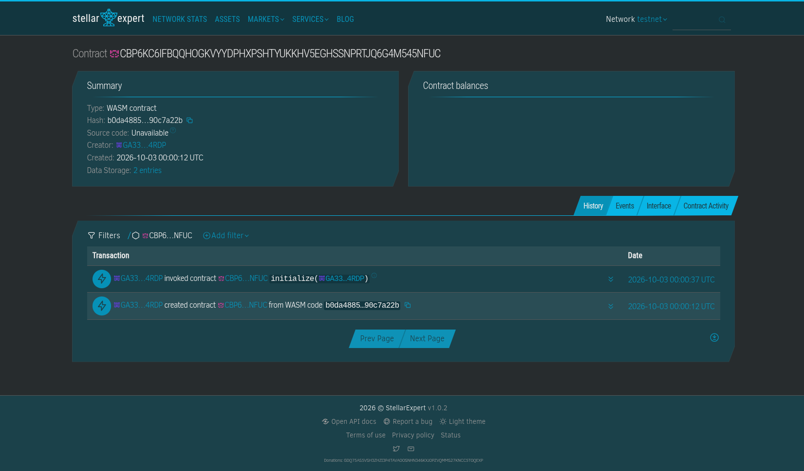
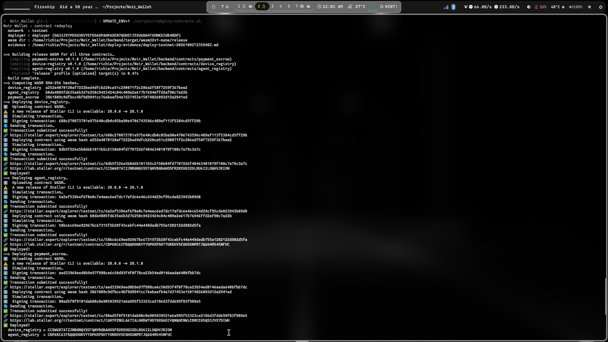
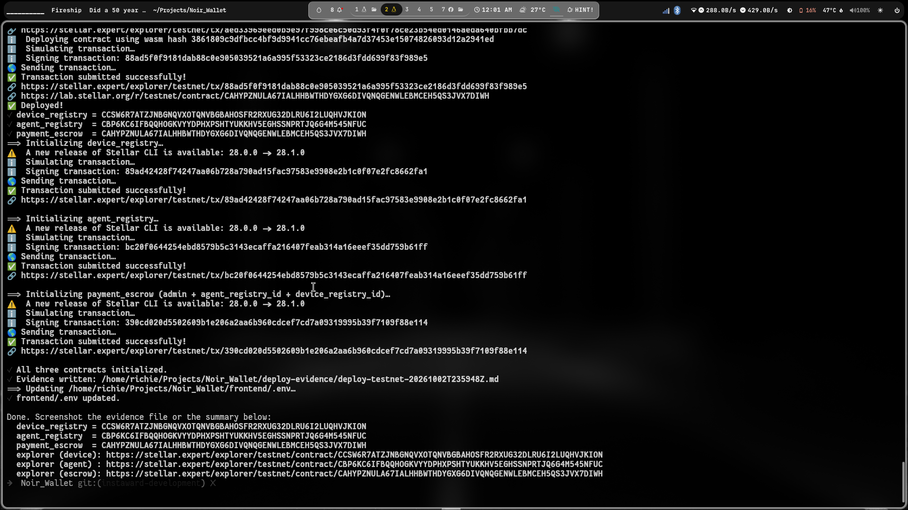
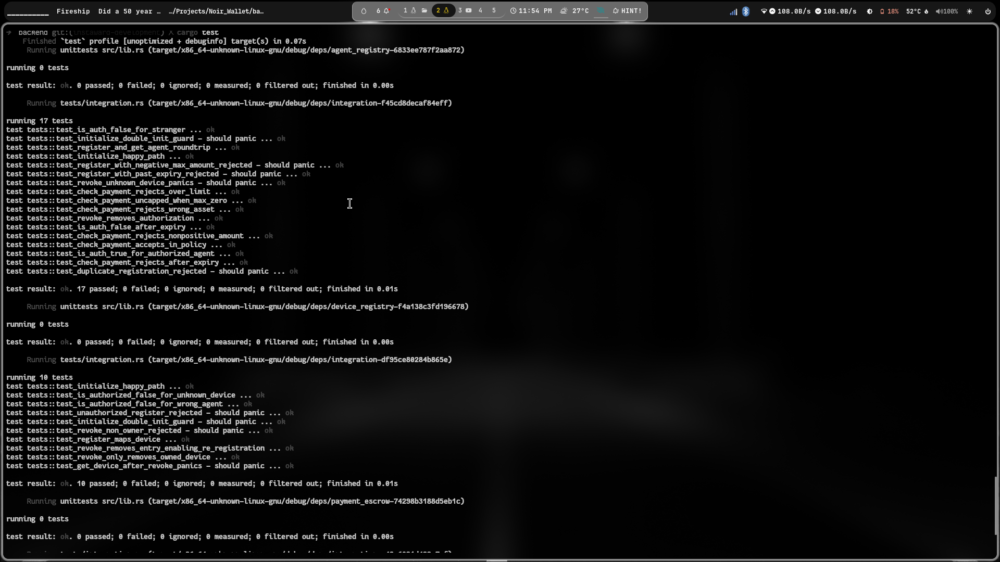
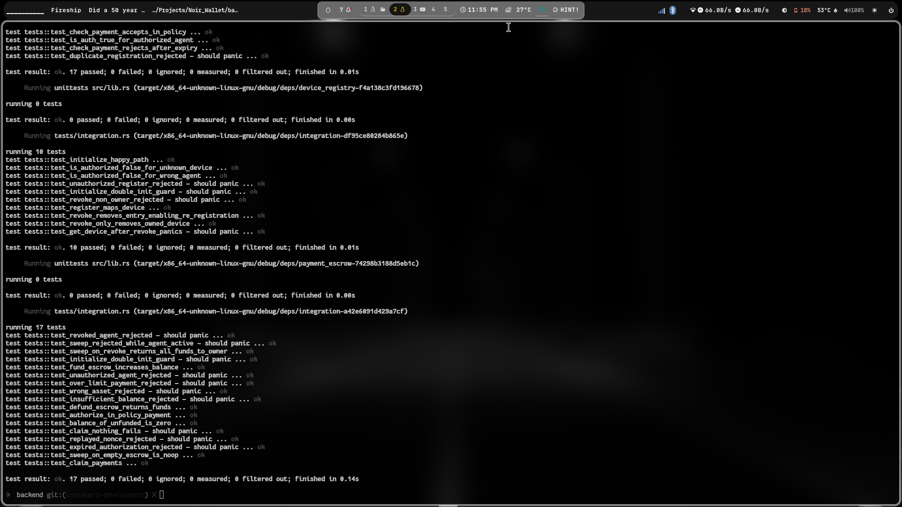

# On-Chain Deployment Evidence — Testnet

Visual proof that the three Noir Wallet Soroban contracts are deployed,
initialized, and verifiable on Stellar testnet. These screenshots back the
contract IDs listed in the [root README](../../README.md#smart-contracts) and
the machine-readable record in
[`deploy-evidence/deploy-testnet-20261024T131024Z.md`](../../deploy-evidence/deploy-testnet-20261024T131024Z.md).

> **Why these IDs change:** each `./scripts/redeploy-contracts.sh` run deploys
> **fresh contract instances**, so every redeploy mints **new contract IDs** —
> it is a clean slate, not an in-place upgrade. The IDs below are from the
> latest run (2026-10-07, deployer `GA33JXYP…4RDP`).
>
> Note: the explorer screenshot filenames below still show the 2026-10-01
> contract IDs (`CCSW6R7A…`, `CBP6KC6I…`, `CAHYPZNU…`) — they predate this
> redeploy and have not been retaken against the current IDs.

## Deployed contracts

| Contract | ID | Explorer |
|----------|----|----------|
| device_registry | `CAC4KOLHDLDYDWBOKXNKRN5KVHO56PLOIFXDLTBUWGVN6GVDEB7FQHU5` | [view](https://stellar.expert/explorer/testnet/contract/CAC4KOLHDLDYDWBOKXNKRN5KVHO56PLOIFXDLTBUWGVN6GVDEB7FQHU5) |
| agent_registry | `CCMZDSPTLX7IIJWCYEUM5DJUHOSOYSTHGK777S2TXZWEMC5ZZGPJ3EBV` | [view](https://stellar.expert/explorer/testnet/contract/CCMZDSPTLX7IIJWCYEUM5DJUHOSOYSTHGK777S2TXZWEMC5ZZGPJ3EBV) |
| payment_escrow | `CC7EAW5FNJEDBS7THM5IT6XIOHO4AOYMLXT3KSZ3HWUIKEACTW7E5BFS` | [view](https://stellar.expert/explorer/testnet/contract/CC7EAW5FNJEDBS7THM5IT6XIOHO4AOYMLXT3KSZ3HWUIKEACTW7E5BFS) |

### WASM SHA-256 hashes

The hash of each deployed WASM — recompute locally with `sha256sum` on the
release build and it must match, proving the on-chain code is exactly what's in
this repo.

| Contract | SHA-256 |
|----------|---------|
| device_registry.wasm | `f2c758eb82b5844b333363b5fd793104106dcafa3f570a5c89d59b4bff580d55` |
| agent_registry.wasm | `064024177246a27709854cc1da45b79be363cd99b84f0d2e74b1b841579c84ab` |
| payment_escrow.wasm | `e430f8ab443103b75a0821612f8fc91d1e7491ac49b2f1e7ddd7698a8073a0a2` |

## Wallet create / import (Android)

Screenshots of import → wallet password → wallet → password lock on a release build:
[`wallet/README.md`](wallet/README.md). Live Testnet run of create/import, device +
agent registration, escrow fund/withdraw and unlink, with tx links:
`deploy-evidence/week2-testnet-flow-*.md`.

## Week 2 captures

[`week2-evidence/`](week2-evidence/): the Google Play beta release page, PR #13
(summary, testing checklist, commits), the three contracts on Stellar Expert, the
owner and agent wallets, and the agent top-up transaction.

## Explorer screenshots

### device_registry — `CCSW6R7A…`

Stellar Expert view of the deployed device registry: maps hardware device
hashes to the owner wallet and its authorized agent.

### agent_registry — `CBP6KC6I…`

The agent registry holding each device's constrained delegated-payment policy
(agent key, per-tap cap, allowed asset, expiry).

### payment_escrow — `CAHYPZNU…`

The escrow contract that pre-funds a device, authorizes payments instantly
against the agent policy, and lets merchants batch-claim.

## Deployment console output

The redeploy script's deploy + initialize output, showing the freshly minted
contract addresses.

## Test suite

All contract tests passing (positive and negative paths) prior to deployment.

