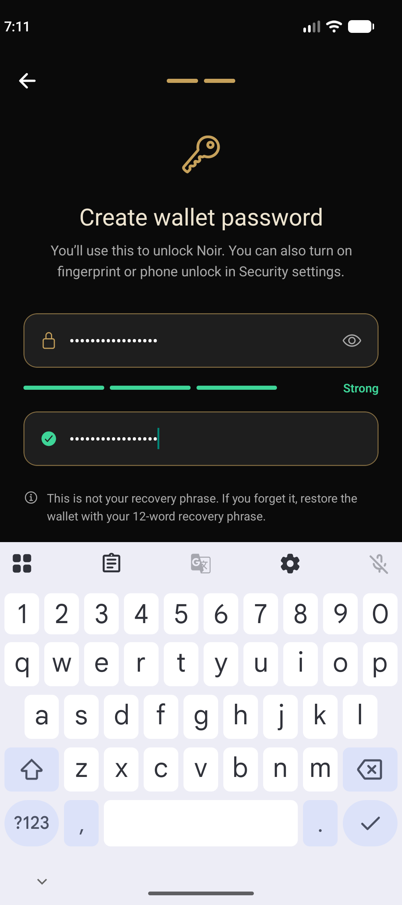
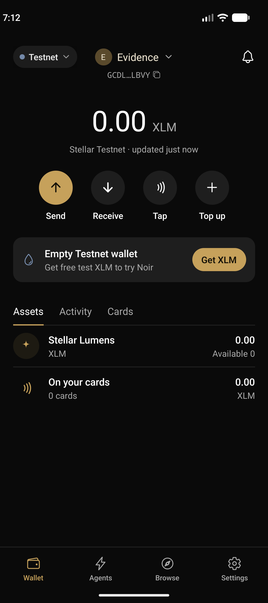
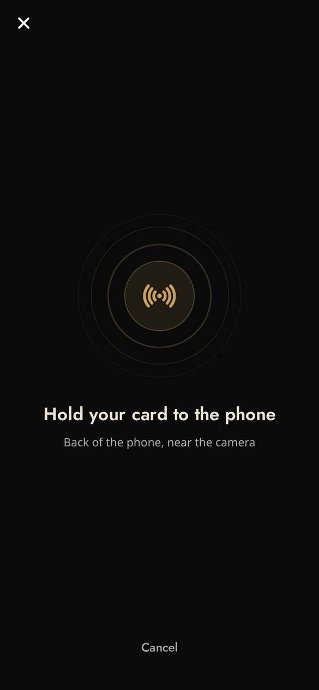
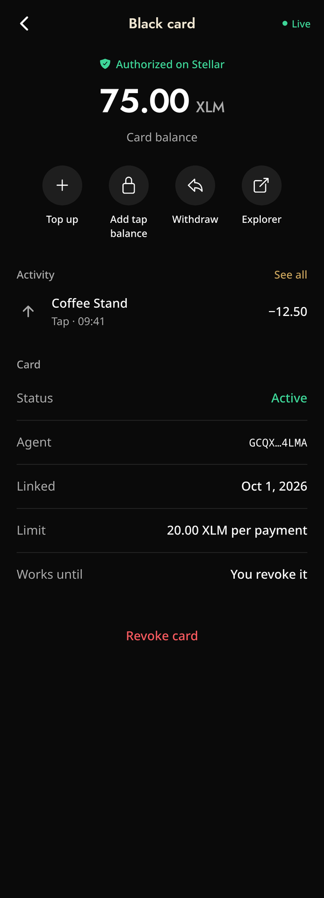
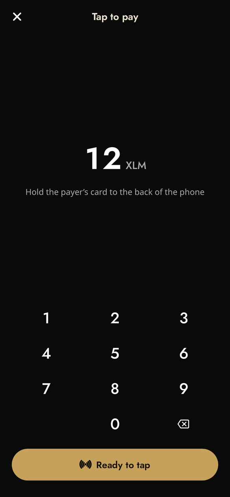

# Walkthrough — NFC-Enabled Delegated Payment Flow

A step-by-step run through the whole reference workflow on Stellar Testnet. Each step names what you do in the app, the contract call it makes, and a **real Testnet transaction** from the recorded run, so a reviewer can check every step on Stellar Expert without installing anything.

```
create/import wallet → read NTAG213 → register device → authorize constrained agent
→ fund escrow → tap → authorize payment → merchant claim → revoke + sweep
```

**Recorded evidence:** [`deploy-evidence/week2-testnet-flow-20261009T044804Z.md`](../deploy-evidence/week2-testnet-flow-20261009T044804Z.md), produced by `npm run test:testnet`. That run uses the app's own `walletService` and `x402` code against the live contracts, with a simulated 7-byte NTAG213 UID.

| Owner wallet | Agent | Device hash |
|--------------|-------|-------------|
| [`GCZPB2PG…CSGBZA`](https://stellar.expert/explorer/testnet/account/GCZPB2PG24UXCJXKHSEYLC75M5UODJKQXQCXHQVSDUCVXC7PHCCSGBZA) | `GAU44HL5…P7D4A3UE` | `1f61859f51c4d811…751da31c` |

Contracts: device_registry `CB4DPMGO…HOWIRA` · agent_registry `CBTDMJVC…IXQ25JZ` · payment_escrow `CA5S4S7Q…D7BYK7HIX` ([deploy record](../deploy-evidence/deploy-testnet-20261007T050558Z.md)).

### Status at a glance

| # | Step | App | Live Testnet evidence |
|---|------|-----|-----------------------|
| 1 | Create / import wallet | ✅ | ✅ |
| 2 | Read NTAG213, hash UID | ✅ | ✅ (simulated UID) · ⏳ physical tag on a phone |
| 3 | Register device | ✅ | ✅ |
| 4 | Authorize constrained agent | ✅ | ✅ |
| 5 | Fund escrow | 🟡 screen exists, no button links to it yet | ✅ |
| 6 | Tap → `authorize` | ⏳ app taps currently pay from the agent wallet | ⏳ to do |
| 7 | Merchant `claim` | ⏳ | ⏳ to do |
| 8 | Withdraw / revoke / sweep / unlink | ✅ | ✅ |

The items marked ⏳ are listed in [Still to do](README.md#still-to-do). Steps 6–7 are implemented and tested in the contracts (`test_authorize_in_policy_payment`, `test_claim_payments`) and in the SDK, but have not been run live from the app yet.

---

## Before you start

- The app on an NFC Android phone ([Installation](installation.md#4-run-the-app-on-an-android-phone)), or the [release APK](https://github.com/rylsherdamz-rgb/Noir_Wallet/releases/tag/Beta-Testing).
- One NTAG213 tag ([NFC hardware](nfc-hardware.md)).
- To reproduce the evidence without a phone: `cd frontend && npm run test:testnet`.

## 1. Create or import a wallet

**App:** Welcome → *Create a wallet* (write down and verify the 12-word phrase) or *I already have a wallet* (import) → set the wallet password. On Testnet the app funds a new account with Friendbot.

**Chain:** no contract call. The account is created by the Friendbot payment.

**Evidence:** run step 1 (create, then import from the same phrase gives the same keys) · screenshots in [`docs/Evidence/wallet/`](Evidence/wallet/README.md).

 

## 2. Provision the NTAG213 tag

**App:** Cards → *Add a card* → *Scan card* → hold the tag to the phone. The app reads the UID, computes `SHA-256(UID string)`, checks `device_registry` to see whether the tag is free, yours, or someone else's, and creates a per-device **agent keypair** in SecureStore.

**Chain:** read-only `get_device` (ownership pre-check).

**Evidence:** run step 5. A second wallet trying to link the same tag is refused with `DeviceOwnedByOtherWalletError` before anything is signed.



## 3. Register the device on-chain

**App:** confirm the card name, then sign in the bottom sheet.

**Chain:** `device_registry.register(wallet, device_hash, agent)`. The owner signs. Fails with `AlreadyRegistered = 4` if the hash already exists.

**Evidence:** [`85f487a8ed07…`](https://stellar.expert/explorer/testnet/tx/85f487a8ed075245de4a565c6df7eaeba654d81bedac08be6355398fb72519a4)

## 4. Authorize a constrained payment agent

**App:** the same signing flow sets the card's policy: per-payment limit, asset (XLM) and *Works until* date. Card detail shows *Authorized on-chain*. If the background step failed, *Authorize on Stellar* retries it.

**Chain:** `agent_registry.register_agent(wallet, device_hash, agent, max_amount, asset, expires_at)`. Policy read back with `get_policy`.

**Evidence:** [`2946d65cf8a7…`](https://stellar.expert/explorer/testnet/tx/2946d65cf8a7cfb407f4dc9bd5d811294a6ffeb17566315218749ea896ec8411). Policy read back as `max 10 XLM/payment, expires 2026-11-08T04:47:11Z` (run step 4).



## 5. Fund the device escrow

**App:** the escrow deposit screen is `/agent-fund/<cardId>?mode=escrow` (`AgentFundScreen`, which calls `x402.fundEscrow`). No button links to it yet. The card's visible *Top up* action funds the agent wallet instead. ⏳ Adding an escrow-deposit entry point is on the to-do list.

**Chain:** `payment_escrow.fund_escrow(token, wallet, device_hash, amount)`. Moves XLM from the owner into the contract and credits `balance_of(device_hash)`.

**Evidence:** [`d6d2f1dba16e…`](https://stellar.expert/explorer/testnet/tx/d6d2f1dba16e36fbb76963d00b5c36420d5b853c253d2ab257346d4505d352f5) (5 XLM deposited).

## 6. Tap to pay → `authorize` ⏳

**Target flow:** tag tapped at the merchant's phone or terminal → UID hashed → the card's agent signs `payment_escrow.authorize(agent, device_hash, merchant, asset, amount, nonce)`. The contract checks the nonce (replay), the policy (agent, asset, cap, expiry) and the escrow balance, deducts the amount and records a pending payment for the merchant.

**App today:** *Tap to pay* resolves the card's agent and sends a standard Stellar payment from the agent wallet (`x402.payWithAgent`). It does not go through the escrow yet.

**Status:** ⏳ to do. Contract behaviour is covered by `test_authorize_in_policy_payment` and every reject test ([Testing](testing.md#sow-security-matrix--tests)). The SDK already implements the call (`NoirAgentClient.authorizePayment`). No live `authorize` transaction yet.



## 7. Merchant settlement → `claim` ⏳

**Target flow:** the merchant calls `payment_escrow.claim(token, merchant)`, which transfers all pending payments in one transfer. `pending_balance(merchant)` shows what is claimable.

**Status:** ⏳ to do. Covered by `test_claim_payments` / `test_claim_nothing_fails`; implemented in the SDK (`NoirAgentClient.claim`) and the REST gateway (`kind: "claim"`). No live `claim` transaction yet.

## 8. Withdraw, revoke and unlink

**App:** card detail → *Withdraw* returns the escrow ("tap balance"). *Revoke card* runs `x402.unlinkDevice`, which revokes in the only safe order, so escrow funds are never stranded.

| Action | Contract call | Evidence |
|--------|---------------|----------|
| Withdraw 2 XLM | `payment_escrow.defund_escrow` | [`489b7b2cab94…`](https://stellar.expert/explorer/testnet/tx/489b7b2cab94000accc0c9638d4ea6a40cc025c7acd4fb2e54d4553c3caa8001) → balance 3 XLM |
| Revoke agent | `agent_registry.revoke_agent` | [`73e0290dcf22…`](https://stellar.expert/explorer/testnet/tx/73e0290dcf22b29d64de33979b4747f060363bcce406b28beb934941595b80c2) |
| Sweep remaining escrow to owner | `payment_escrow.sweep_on_revoke` | [`97d59dbcf0c7…`](https://stellar.expert/explorer/testnet/tx/97d59dbcf0c728b9e8363656d5fe676d1b411090bec1e76fc094d8ae78afb27a) → 3 XLM returned |
| Revoke device | `device_registry.revoke` | [`34ddcd899772…`](https://stellar.expert/explorer/testnet/tx/34ddcd899772958c7940d00ee529b90f5d87b0bcb9b6bb8de3c6576e2c6b5990) → tag free to link again |

After revocation the agent can no longer spend (`check_payment` → false, `authorize` → `AgentNotAuthorized = 3`), and the swept funds are back in the owner's wallet.

---

## Demo video

| Video | What it shows |
|-------|---------------|
| [`assets/x-demo.mp4`](../assets/x-demo.mp4) | Tap-to-pay with per-device agent wallets in the mobile app |
| [`assets/noir-demo.mp4`](../assets/noir-demo.mp4) | 95-second narrated walkthrough of the app and the tap flow |
| [Noir on X](https://x.com/Noirx402/status/2109282993588334632) | Promo video shown on the landing page |

⏳ **To do:** record the final Instaward walkthrough on a real phone with a physical NTAG213 covering steps 1–8, including the live `authorize` and `claim` once they are wired in.

Related: [Architecture](architecture.md) · [Contract reference](contracts.md) · [Testing](testing.md)
